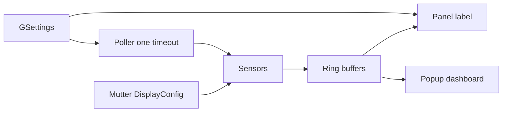

# Stats GNOME Shell extension

Source tree is the workspace root [`/home/emm/projects/stats`](/home/emm/projects/stats) (it is empty). `make install` symlinks it to `~/.local/share/gnome-shell/extensions/stats@local`. The UUID is only in [`metadata.json`](metadata.json); the install directory name must match it.

This host is GNOME Shell 50.1, GJS 1.88, libadwaita 1.9, Intel iGPU `card1` (`0x8086`, both `gt_act_freq_mhz` and `gt/gt0/rps_act_freq_mhz`), `coretemp`, one built-in monitor at a nominal 59.9985 Hz. `nvidia-smi`, `intel_gpu_top`, `gnome-system-monitor`, and `/usr/libexec/mutter-devkit` are not installed. System ESLint is 6.4 and cannot load flat config; Node 22 and npm are available.

Work proceeds one phase at a time. After each phase I will stop, list files, and say how to test it. The tree stays loadable at every phase.

## APIs to use (verified, not guessed)

- Extension entry: `Extension` from `resource:///org/gnome/shell/extensions/extension.js`, `enable()` / `disable()`, `this.getSettings()`, `this.openPreferences()`. Prefs: `ExtensionPreferences.fillPreferencesWindow(window)` with Adw 1.9 `PreferencesPage`, `SwitchRow`, `ComboRow`, `SpinRow` (confirmed present via `gjs`). No `Gtk` import in the Shell process.
- Panel: `Main.panel.addToStatusArea(role, indicator, position, box)` in gnome-shell 50.1 [`js/ui/panel.js`](https://gitlab.gnome.org/GNOME/gnome-shell/-/raw/50.1/js/ui/panel.js). `position ??= 0` and `box` is `'left'` | `'right'`. Always pass the index. Indicator must be a `PanelMenu.Button`. `destroy()` drops the `statusArea` role, so recreate only after the old button is destroyed.
- Lock/idle: `Main.screenShield` emits `locked-changed` and `active-changed` and exposes `.locked` / `.active` (gnome-shell 50.1 `js/ui/screenShield.js`; `locked-changed` has existed since 2021, so 46–50 share it). Pause polling when either is true if `pause-when-locked` is on.
- Sparklines: `St.DrawingArea` `repaint` → `area.get_context()` → `cr.$dispose()`. Theme colour from the widget style node; only warning/critical colours are hard-coded in CSS.
- Displays: session bus `org.gnome.Mutter.DisplayConfig` `/org/gnome/Mutter/DisplayConfig` `GetCurrentState` → `(u serial, a((ssss)a(siiddada{sv})a{sv}) monitors, logical_monitors, a{sv})`. Current mode has property `is-current`. Signal `MonitorsChanged`. Confirmed live on this machine (`eDP-1`, 1366×768 @ 59.9985, `is-current` true). Refresh is the **nominal** mode rate; `refresh-rate-mode` `variable` is VRR and is not an instantaneous rate. Comment and README say so. No polling for this sensor.
- NVIDIA stream: persistent `Gio.Subprocess` plus `Gio.DataInputStream.read_line_async`. `communicate_utf8_async` only for one-shot commands, because it waits until the process exits. Do not start `nvidia-smi` when `runtime_status` is `suspended`.
- Async file reads: `Gio.File.load_contents_async` / `query_filesystem_info_async` with a `Gio.Cancellable` cancelled in `destroy()`.

## Layout and data flow

- One sensor interface: `id`, `label`, `async init()`, `async sample()`, `destroy()`. Register sensors in one list in [`lib/poller.js`](lib/poller.js).
- One `GLib.timeout_add` (500–10000 ms, default 1000). Skip a tick if the previous tick is still running. Parallel `sample()` via `Promise.all`. Log a missing-file failure once per sensor with `console.warn('[stats] ...')`.
- Ring length follows the history window: `history-seconds` 30/60/120 divided by the poll interval (60 samples at the default 1 s). Counter deltas treat a negative delta as a reset and clamp percents to 0–100.
- [`lib/constants.js`](lib/constants.js) holds the schema id `org.gnome.shell.extensions.stats`. UUID stays in metadata only.

## Settings

Schema [`schemas/org.gnome.shell.extensions.stats.gschema.xml`](schemas/org.gnome.shell.extensions.stats.gschema.xml), compiled by `glib-compile-schemas`. Keys:

- `position` enum `left|right` (default `right`), `position-index` int (default `0`, range 0–20). Choosing Left in prefs sets the index to `1` when it is still `0`, so the indicator sits after Activities.
- `poll-interval-ms`, `temperature-unit` (`c|f`), `display-mode` (`icon-text|text|compact`), `pause-when-locked` (default true).
- `bar-metrics` `as`, default `['cpu','memory','gpu','temperature','refresh']`. Order is bar order; absence means hidden. `gpu-id` string (`''` = auto: active discrete, else the active iGPU). `headline-temp` string (`''` = CPU package). `mount-points` `as` default `['/']`.
- Threshold ints: usage warning/critical default 70/90 for CPU, RAM, storage, GPU; temp 75/90 °C.
- `show-sparklines` (true), `history-seconds` (60), `show-per-core` (true).

Bar value choices: storage is used-percent of the first mount (throughput stays in the popup); refresh is the primary logical monitor; compact mode shows the first enabled metric until hover.

## Sensors

Pure parsers live next to each sensor and take strings or plain objects so [`tests/parse.test.js`](tests/parse.test.js) can run under `gjs -m` with no Shell imports.

- CPU: `/proc/stat` deltas (`idle+iowait` vs total), per-core and overall. Frequency from `scaling_cur_freq` (kHz); hide if missing.
- Memory: `MemTotal - MemAvailable`, swap, cached, percent. Never `MemFree`.
- Storage: `filesystem::size/used/free` on each mount. `/proc/diskstats` sector deltas × 512. Skip `loop`, `ram`, `dm-*`, and partitions whose parent is already counted.
- Temperature: hwmon scan. CPU `coretemp` Package id 0, else `k10temp` Tctl/Tdie, else thermal zone `x86_pkg_temp`. Disk: nvme composite. GPU: amdgpu hwmon, else NVIDIA sample. Millidegrees to °C/°F.
- GPU ([`lib/sensors/gpu/index.js`](lib/sensors/gpu/index.js)): vendor from `/sys/class/drm/card*/device/vendor` (`0x10de` / `0x1002` / `0x8086`). Skip `suspended` and show `idle/off`. NVIDIA CSV line parser plus persistent `nvidia-smi -l 1`, restart with backoff. AMD sysfs busy/VRAM/temp. Intel frequency from the newer `gt/gt0/rps_act_freq_mhz` path when present, else `gt_act_freq_mhz`; `intel_gpu_top -J` only if it runs, otherwise utilisation `n/a`.
- Display: cache updated on `MonitorsChanged`, not by the poller. UI shows connector, resolution, Hz. Round 59.9985 to `60 Hz` for display only.

## UI and prefs

- Bar: horizontal `St.BoxLayout`, symbolic icon plus tabular-nums label, min-width so digits do not shift the panel. CSS classes `stats-warning` / `stats-critical`.
- Popup sections: CPU (overall, per-core meters, frequency), memory, mounts plus read/write, per-GPU, all temps, monitors. Sparklines for CPU, RAM, GPU, disk throughput, temperature. Footer: Preferences via `openPreferences()`, and System Monitor via `Shell.AppSystem` `gnome-system-monitor.desktop` only if installed.
- Prefs pages: General, Metrics (switches, up/down reorder, GPU, headline temp, extra mounts), Thresholds, Popup, About (version, placeholder link row that does not fetch anything, Reset calls `settings.reset` on every key).

## Tooling

- [`Makefile`](Makefile): `schemas`, `install` (symlink + compile schemas + print enable command), `enable`, `disable`, `logs` (`journalctl -f -o cat /usr/bin/gnome-shell`), `test`, `pack` (`gnome-extensions pack` with `--extra-source` for `lib` and `tests`), `lint`.
- [`eslint.config.js`](eslint.config.js) plus a small [`package.json`](package.json) devDependency on ESLint 9 (flat config). `make lint` uses that binary, not `/usr/bin/eslint`.
- [`README.md`](README.md): Wayland reload is log out/in. Nested session on GNOME 49+ is `dbus-run-session -- gnome-shell --devkit --wayland` and needs Ubuntu package `mutter-dev-bin` (`/usr/libexec/mutter-devkit`). GNOME 48 and earlier: `dbus-run-session -- gnome-shell --nested --wayland`. Document VRR as nominal-only. Document the 20× enable/disable leak check (`journalctl`, no leftover `nvidia-smi`).

## Phases

Each phase ends with a short summary and a test command. Shell enable cannot be proven from this session without a nested Shell; parser tests, schema compile, and `gjs` syntax checks can run here. Live panel checks need logout or `mutter-dev-bin`.
